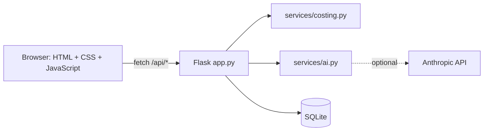

# விலைத் தோழி · VilaiThozhi

[](LICENSE)


A **Tamil-first** web prototype that helps women's self-help group (SHG) members
estimate production cost, set a fair selling price and create product listings.

**Live demo (static, in-browser):** https://dharshni9627-pixel.github.io/vilai-thozhi/

> **Demo flow:** enter ingredient, packaging and labour costs for a homemade product →
> get a cost breakdown, a suggested price range (minimum / suggested / maximum) and a
> Tamil + English product listing.

## Problem and solution
Members of women's self-help groups often find it hard to calculate product costs, set
selling prices and write clear product descriptions. VilaiThozhi gives them a simple
Tamil-language tool for all three.

## Features
- Tamil / English interface toggle (Tamil by default)
- Cost breakdown with a donut chart, cost per unit and a profit-based price range
- **AI:** product description from a **photo + notes** (vision model, optional)
- **AI:** plain-language **cost explanation** in Tamil and English
- **AI:** **Tamil → English** listing translation
- Save, print and delete listings (SQLite)
- Works fully **offline** with template text when no API key is set

## Architecture (overview)

Full design, sequence diagrams and data model: [documentation/TECHNICAL_DESIGN.md](documentation/TECHNICAL_DESIGN.md)

## Tech stack
Flask · vanilla JavaScript · SQLite · optional Anthropic API (vision + language)

## Prerequisites
- Python 3.10 or newer
- Git
- (Optional) an Anthropic API key for the AI features

## Setup

### Windows (Command Prompt / VS Code terminal)
```bat
git clone https://github.com/dharshni9627-pixel/vilai-thozhi.git
cd vilai-thozhi
py -m venv venv
venv\Scripts\activate
pip install -r requirements.txt
copy .env.example .env
flask --app app run --debug
```

### macOS / Linux
```bash
git clone https://github.com/dharshni9627-pixel/vilai-thozhi.git
cd vilai-thozhi
python3 -m venv venv
source venv/bin/activate
pip install -r requirements.txt
cp .env.example .env
flask --app app run --debug
```
Open http://127.0.0.1:5000. On the calculator page click **மாதிரித் தரவை நிரப்பு** (Fill demo data).

## Environment variables
Set these in a `.env` file in the project root (copy `.env.example`). Never commit `.env`.

| Variable | Required | Default | Purpose |
|---|---|---|---|
| `ANTHROPIC_API_KEY` | No | empty | Enables AI listings, explanations, photo analysis and translation. Empty = offline demo mode. |
| `ANTHROPIC_MODEL` | No | `claude-sonnet-5-5` | Model used for the AI features. |
| `SECRET_KEY` | No | `dev-only` | Flask secret key. Not used for sessions yet; set a random value before any real deployment. |
| `FLASK_DEBUG` | No | off | `1` enables debug mode when running `python app.py`. |
| `SHG_DB_PATH` | No | `instance/shg.db` | Overrides the SQLite file location (the tests use this). |

## Sample data
`sample_data/demo_products.json` holds five Tamil sample products (pickles, murukku, palm-leaf
basket, herbal soap) with expected results. Load them into the app:
```bash
python sample_data/seed.py
```
Details: [sample_data/README.md](sample_data/README.md)

## Tests
```bash
python -m unittest discover tests
```
26 automated tests cover the pricing logic, the sample data and every API route.
Test case list: [documentation/TEST_CASES.md](documentation/TEST_CASES.md)

## Project structure
```
app.py                       Flask routes + SQLite
services/costing.py          Cost, price range, explanations (pure Python)
services/ai.py               Vision / LLM calls with offline fallback
templates/                   base, home, calculator, products
static/css/style.css         Theme
static/js/i18n.js            Tamil / English strings
static/js/app.js             Calculator + saved products UI
static/img/                  logo.svg, hero.svg
sample_data/                 Sample products + seed script
tests/                       Unit and API tests
documentation/               Technical design, test cases
docs/                        Static build served by GitHub Pages
static_demo/local-api.js     Browser-only replacement for the API (GitHub Pages)
build_static.py              Builds docs/ from the Flask templates
```

## API
| Method | Route | Purpose |
|---|---|---|
| POST | `/api/generate` | multipart: `data` (JSON) + optional `photo` → cost + listing |
| POST | `/api/translate` | Tamil title/description → English |
| POST | `/api/save` | Save a product |
| GET | `/api/products` | List saved products |
| DELETE | `/api/products/<id>` | Delete a product |

## Pricing method
`cost per unit = total batch cost ÷ units`, then `price = cost per unit × (1 + profit%)`,
rounded **up** to the next rupee (under ₹20) or next ₹5 (₹20 and above).
Minimum price uses profit − 15 points (never below 5%); maximum uses profit + 20 points.

## GitHub Pages demo
`docs/` is a static, browser-only version (no server, no AI; saved products live in the
browser's localStorage). After changing templates or JS, rebuild and push:
```bash
python build_static.py
git add . && git commit -m "Update static demo" && git push
```
Enable once: repo **Settings → Pages → Deploy from a branch → main → /docs → Save**.

## Notes and limitations
- Review AI-written Tamil before publishing; the prompt forbids invented certifications or health claims.
- There is no login: this is a single-user prototype.
- Ideas: Tamil voice input, WhatsApp share, group accounts, wastage % field, market-price comparison.

## License
[MIT](LICENSE)
