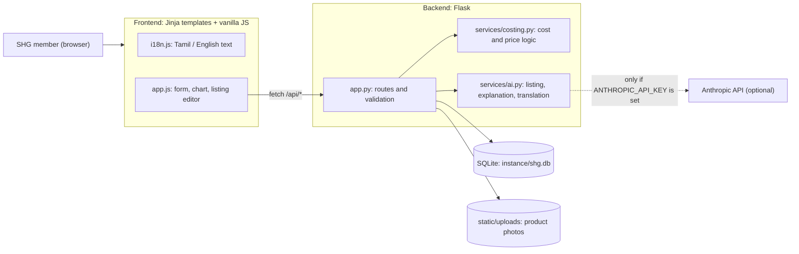
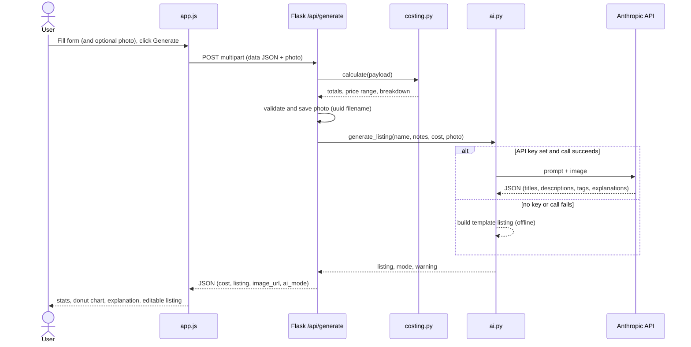
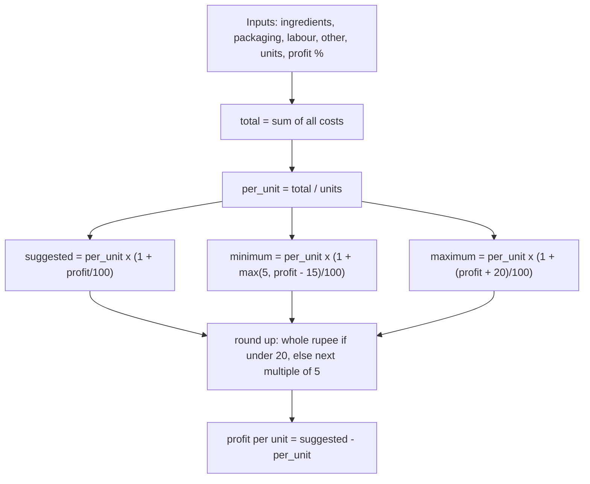
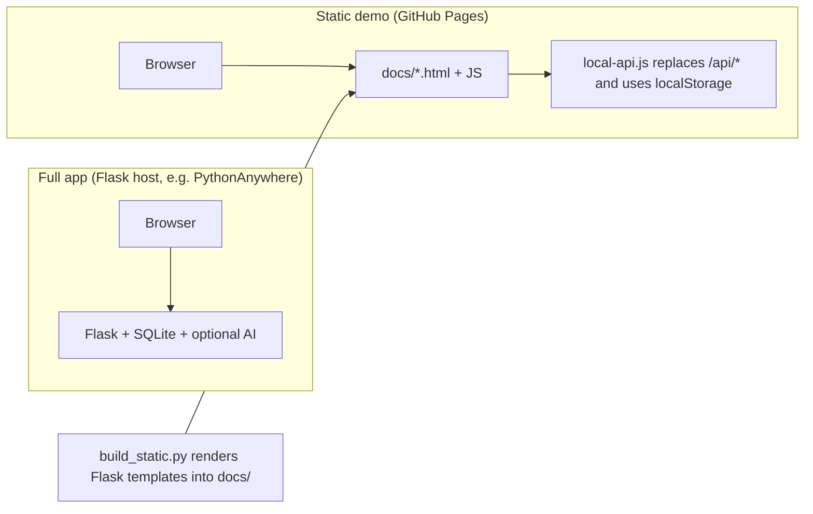
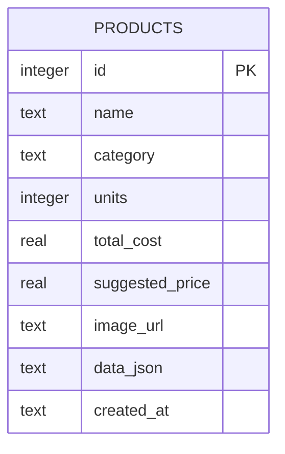

# Technical Design Document: VilaiThozhi (விலைத் தோழி)

| | |
|---|---|
| **Status** | Prototype v0.1 |
| **Repository** | https://github.com/dharshni9627-pixel/vilai-thozhi |
| **Stack** | Flask, vanilla JavaScript, SQLite, optional Anthropic API |

## 1. Purpose and scope
Members of women's self-help groups (SHGs) often find it difficult to calculate product costs,
set selling prices and write clear product descriptions. VilaiThozhi is a Tamil-first website that:

1. calculates the cost of a production batch and the cost per unit,
2. suggests a price range with a built-in profit,
3. generates a bilingual (Tamil / English) product listing from notes and an optional photo.

**In scope:** costing, price range, listing generation, translation, saving listings, Tamil/English UI.
**Out of scope (prototype):** user accounts, payments, ordering, inventory, multi-group management.

## 2. Requirements

### Functional
| ID | Requirement |
|---|---|
| FR1 | User enters ingredient, packaging, labour and other costs, units per batch and desired profit %. |
| FR2 | System shows total cost, cost per unit and a cost breakdown by category. |
| FR3 | System suggests minimum, suggested and maximum selling prices. |
| FR4 | System explains the numbers in simple Tamil and English. |
| FR5 | System creates a listing (title + description) in Tamil and English from notes and an optional photo. |
| FR6 | User can edit the listing and re-translate Tamil → English. |
| FR7 | User can save, view, print and delete listings. |
| FR8 | Interface works in Tamil (default) and English. |

### Non-functional
| ID | Requirement |
|---|---|
| NFR1 | Works with no AI key (offline fallback) so the demo never breaks. |
| NFR2 | Usable on a phone: responsive layout, large touch targets. |
| NFR3 | Simple language and few fields, aimed at first-time digital users. |
| NFR4 | Secrets never stored in the repository. |
| NFR5 | Core logic is pure Python and unit-testable without a server. |

## 3. Architecture

### 3.1 Component view

### 3.2 Layers and responsibilities
| Layer | Files | Responsibility |
|---|---|---|
| Presentation | `templates/`, `static/css`, `static/js` | Pages, form, donut chart, language toggle, listing editor. |
| API / controller | `app.py` | Routing, input validation, file upload handling, persistence. |
| Domain logic | `services/costing.py` | Cost totals, price range, rounding, plain-language explanation. No Flask imports. |
| AI integration | `services/ai.py` | Prompting, JSON parsing, offline fallback, Tamil glossary. |
| Storage | SQLite file, `static/uploads/` | Saved products and photos. |

### 3.3 Request flow: generate cost and listing

### 3.4 Pricing algorithm

The profit is a **markup on cost**, not a margin on selling price. Worked example (sample S1):
total ₹455 / 10 = ₹45.50; × 1.30 = 59.15 → ₹60; profit ₹14.50 per unit.

### 3.5 Deployment views

The static demo reuses the same templates, CSS and `app.js`. `static_demo/local-api.js` intercepts `fetch("/api/...")`
and runs a JavaScript port of the costing and offline-listing logic, so no server is needed. It has no AI.

## 4. Data model

`data_json` stores the full `cost` object (breakdown, price range, explanations inputs) and the `listing`
object (Tamil/English titles and descriptions, tags, explanations). The flat columns exist for quick listing and future filtering.

Listing object keys: `title_ta, title_en, description_ta, description_en, tags[], explanation_ta, explanation_en`.

## 5. API specification
| Method | Route | Request | Success response | Errors |
|---|---|---|---|---|
| POST | `/api/generate` | multipart: `data` (JSON string), optional `photo` (JPG/PNG/WEBP, ≤ 6 MB) | `{cost, listing, image_url, ai_mode, warning}` | 400 invalid costs / missing name / bad photo type; 413 too large |
| POST | `/api/translate` | `{title, description}` (Tamil) | `{title, description, mode}` | 400 nothing to translate |
| POST | `/api/save` | `{name, category, cost, listing, image_url}` | `{id}` | 400 incomplete data |
| GET | `/api/products` | none | list of saved products, newest first | none |
| DELETE | `/api/products/<id>` | none | `{ok: true}` | none |

`data` payload fields: `name, category, units, margin, ingredients[{name,cost}], packaging, labour, other, notes`.

## 6. AI design
| Feature | Approach |
|---|---|
| Listing from photo and notes | One prompt with product name, category, ingredient names, notes, cost summary and the photo (base64). Model must return **only JSON**. |
| Cost explanation | Same call; two or three short sentences on where the money goes and why the range is suggested. |
| Tamil → English | Separate prompt returning `{title_en, description_en}`. |

**Safety and quality rules in the prompt:** simple Tamil; 50–80 words; no invented certifications, health claims or ingredients;
no prices in the description; describe only what is visible in the photo.

**Fallback (offline mode):** if no key is set, or the API call or JSON parse fails, `ai.py` returns a template listing and a
rule-based explanation, and the UI shows a "demo mode" badge. A warning is shown if a configured call failed. English
offline translation uses a small Tamil→English glossary and is intentionally basic.

## 7. Security and privacy
| Area | Measure |
|---|---|
| Secrets | API key only in `.env`, ignored by Git (`.gitignore`); `.env.example` documents variables. |
| Input validation | Numeric parsing with non-negative checks, units ≥ 1, string length limits, profit capped at 300%. |
| Uploads | MIME allow-list (JPG/PNG/WEBP), 6 MB request limit, random UUID filenames, stored under `static/uploads/`. |
| Image URLs | `/api/save` accepts only `/static/uploads/...` paths; anything else is stored as null. |
| SQL | Parameterised queries only. |
| XSS | Dynamic HTML in `app.js` is escaped (`esc()`); Jinja autoescape for templates. |
| Debug | Off unless `FLASK_DEBUG=1`. |
| Data sent to AI | Product name, notes, ingredient names, cost summary and the photo, only when a key is configured. |

## 8. Error handling
- Backend returns JSON `{error: "..."}` with 4xx codes; the UI shows it in a toast.
- AI failures never block the user: the offline listing is returned with a warning.
- Frontend wraps `localStorage` access in try/catch (language preference).

## 9. Testing strategy
| Level | What | Where |
|---|---|---|
| Unit | Costing, rounding, validation, explanations | `tests/test_costing.py` |
| Data-driven | Five sample products vs expected totals and prices | `tests/test_samples.py`, `sample_data/` |
| API | All routes, uploads, save/list/delete, security checks (temp DB, offline mode) | `tests/test_api.py` |
| Manual | Tamil rendering, language toggle, responsive layout, print | See `TEST_CASES.md` |

Run: `python -m unittest discover tests`. Case list: [TEST_CASES.md](TEST_CASES.md).

## 10. Known limitations
- No authentication; all saved products on a server instance are shared.
- Markup-on-cost pricing only; no wastage %, GST or market-price comparison.
- Offline English translation is word-level and rough; AI mode is far better.
- Static GitHub Pages demo saves to the visitor's browser only and has no AI.
- Free hosts may erase SQLite data and uploads on restart.

## 11. Future work
1. Tamil voice input and read-aloud results.
2. Group accounts with login and shared product catalogue.
3. Wastage %, overhead sharing, GST and bulk/wholesale pricing.
4. WhatsApp share of the listing and a printable price card.
5. Compare prices with local market data.
6. PostgreSQL and object storage for photos when hosted.
